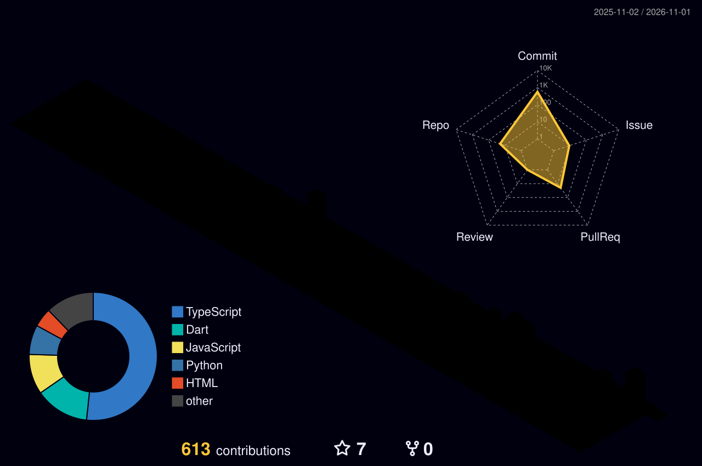
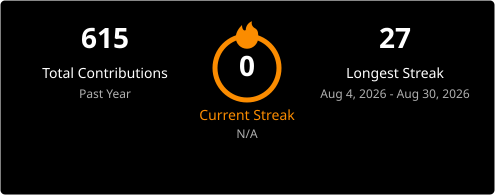

# Anmol Garg

AI/ML &nbsp;·&nbsp; Autonomous Systems &nbsp;·&nbsp; Full-Stack

 

## About

3rd-year B.Tech AI & Data Science student at VIPS Delhi. This summer I interned as a Software Engineer at **7rd.ai** (June–August 2026), where I built the Windows ground-control application (Electron, React, TypeScript) for an autonomous drone defense platform and deployed an autonomous AI agent on production infrastructure, cutting manual operational work by 40%.

I work across the stack that sits between a model and a shipped product: training and deploying ML systems, building the APIs and backends around them, and the interfaces people actually use. Outside coursework and the internship, I build independent projects end-to-end: IoT hardware, NLP pipelines, autonomous detection systems, MCP tooling, and full-stack applications.

---

## Recognition

- **India Innovates 2026** — National Finalist
- **Samsung Solve for Tomorrow 2025** — Top 10 nationally, from 20,000+ competing teams
- **Supernova Hackathon, GL Bajaj (2025)** — 1st Place
- **Google Student Ambassador 2026** — 1 of ~50 selected nationally

---

## Projects

### [AIRAVAT XDR](https://github.com/AnmolGarg8/AirawatXdr) — Autonomous AI Cyber Defense Platform
National Finalist, India Innovates 2026. Built with a 4-member team. Combines Isolation Forest anomaly detection with an NLP phishing classifier into a single risk-scoring engine, feeding an automated response system (account lockdown, device isolation). Sub-2s response latency, under 5% false-positive rate. Backend in FastAPI, dashboard in React.
`Python` `FastAPI` `React` `Scikit-learn` `NLP` — [Live demo](https://www.airavatxdr.in/)

### [ZeroWaste Kitchen](https://github.com/AnmolGarg8/zerowaste-kitchen) — Persistent Food Memory for Alexa+
Built for the Amazon Developer Hackathon 2026. An open-source MCP server that gives Alexa+ persistent memory of household food (expiry tracking, shopping gaps, waste reports) through five stateless tools over Streamable HTTP, following MCP spec 2025-11-25. Designed around Alexa+'s 500 ms response limit by keeping LLM calls out of the request path. Verified with 15 automated tests, including an end-to-end test over real HTTP, plus a browser simulator that shows live JSON-RPC calls and latency.
`Python` `MCP (FastMCP)` `SQLite` `pytest`

### [SAMARTH-AI](https://github.com/AnmolGarg8/AiKOSH) — Government Taxonomy Classifier
Full-stack NLP system that maps plain-language product descriptions to 500+ government taxonomy categories: 80% accuracy, 70% less manual classification effort, and processing time cut from 10+ minutes to under a second.
`Python` `FastAPI` `React` `NLP`

### [NoteNetra](https://github.com/AnmolGarg8/Note) — Offline IoT Cash Tracking
Top 10, Samsung Solve for Tomorrow 2025. ESP32-based system that digitizes informal shopkeeper cash transactions into structured, bank-ready credit data, built and validated with real shopkeepers, targeting 1,000+ daily transactions.
`ESP32` `C++` `Python`

Earlier: [PulmoWarn](https://github.com/AnmolGarg8/Pulmowarn) — dual-sensor (acoustic + CO₂) respiratory monitoring concept with a real-time Canvas API visualization.

---

## Stack

**Languages** — Python, Java, JavaScript, TypeScript, C++, C, SQL

**AI / ML** — PyTorch, TensorFlow, scikit-learn, NLP, Pandas, NumPy, OpenCV

**Full-Stack & Frameworks** — React, Next.js, FastAPI, Electron, Flutter, MCP (Model Context Protocol)

**Systems & Cloud** — Linux, Git, Docker, AWS (S3, EC2), MySQL, Postman, pytest

**Hardware / IoT** — ESP32, Embedded C/C++

---

## GitHub Activity

  

---

## Currently

Working on agent tooling with MCP, latency-bounded AI services, and the systems layer around production AI: Docker, AWS, Linux. Open to AI/ML and software engineering internship and research conversations.

